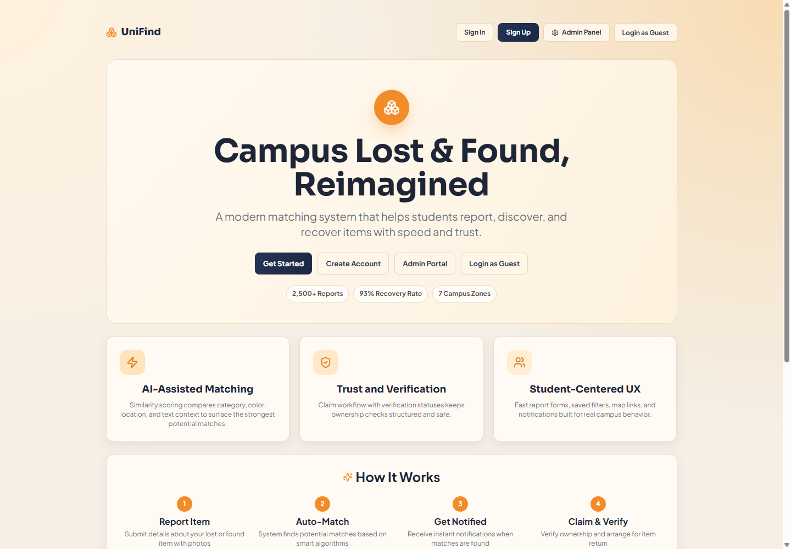
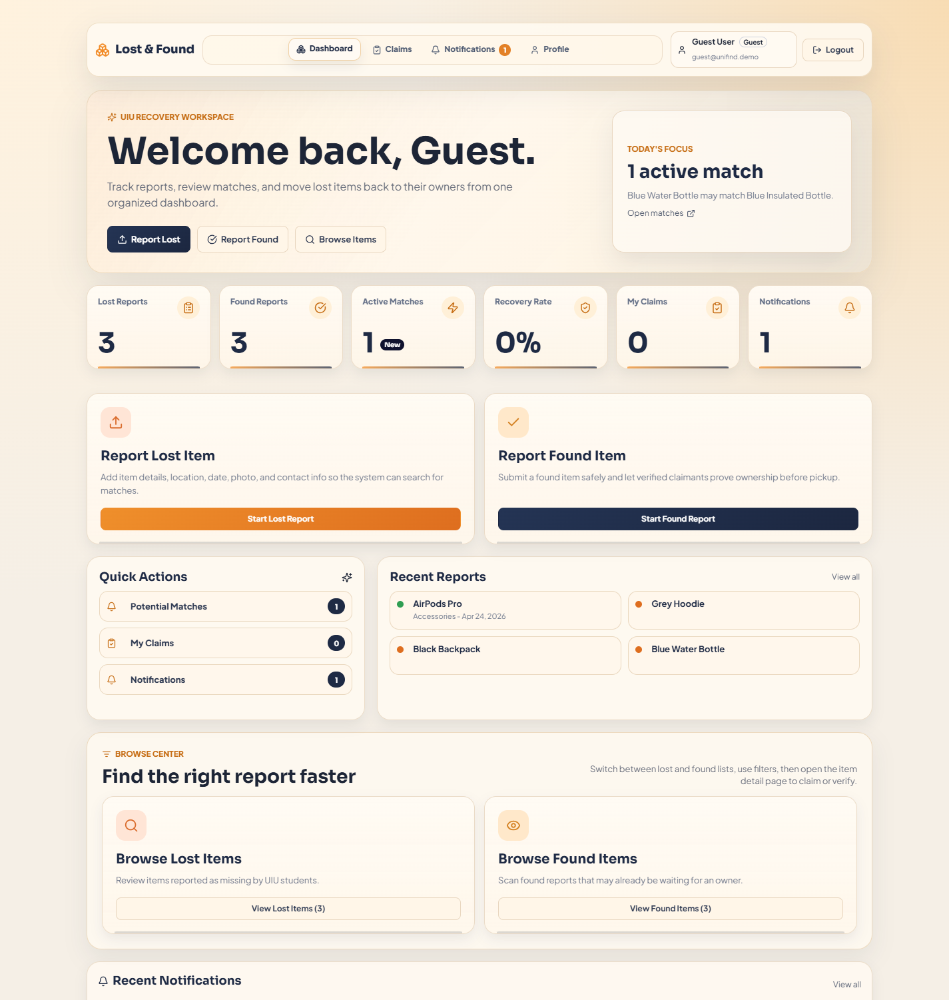

# UniFind

[Explore the live showcase](https://unifind-showcase.vercel.app) · [Portfolio screenshots](docs/showcase/README.md)



UniFind is a campus lost-and-found application that helps students report missing belongings, discover found items, review potential matches, and coordinate ownership claims. A dedicated administration workspace organizes reports, users, claims, locations, and notifications.

The live showcase is an interactive browser-only demo. It uses fictional sample records and local storage; authentication and administration are simulated, and changes stay in the current browser.

## Main features

- Student dashboard with report counts, recent activity, matches, and notifications
- Lost- and found-item reporting with descriptions, photos, dates, and locations
- Search, category and location filters, sorting, and saved filters
- Similarity matching based on item category, color, location, and description
- Ownership claims, review statuses, and return tracking
- Administration dashboard for reports, claims, users, and campus locations
- Responsive desktop and mobile layouts

## Stack and structure

The showcase uses React, Vite, React Router, Zustand, Framer Motion, and Lucide icons. Vercel serves the static production build.

| Directory | Contents |
| --- | --- |
| `react-unifind/src` | Frontend pages, state, and styling |
| `react-unifind/public` | Static assets |
| `react-unifind/server` | Separate backend source, not deployed by the showcase |
| `docs/showcase` | Desktop and mobile portfolio screenshots |

## Run locally

Install a current Node.js LTS release and npm, then run:

```bash
cd react-unifind
npm ci
npm run dev
```

Open the local URL printed by Vite, normally `http://localhost:5173`.

## Demo access

Choose **Login as Guest** on the home page to explore the student workspace.

For the demo administration workspace, open `/admin`:

| Email | Password |
| --- | --- |
| `admin@unifind.demo` | `UniFindDemo123!` |

These are public demonstration credentials. The showcase does not provide production authentication or shared storage.

## Build and preview

```bash
cd react-unifind
npm run build
npm run preview
```

## Screenshots

Eight images are available in the [portfolio screenshot gallery](docs/showcase/README.md), covering the landing page, student dashboard, item browser, administration dashboard, reporting form, item details, and mobile layout.



## Vercel showcase

Live site: **https://unifind-showcase.vercel.app**

The Vercel project builds the frontend from `react-unifind` using `npm run build` and publishes `dist`. The included `vercel.json` rewrites application URLs to `index.html`, so direct links and page refreshes work.

The landing-page statistics are sample marketing content, not verified usage or recovery results.
