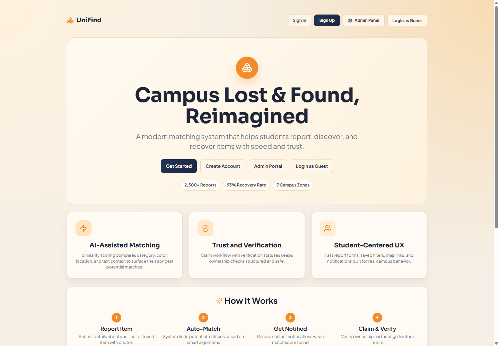
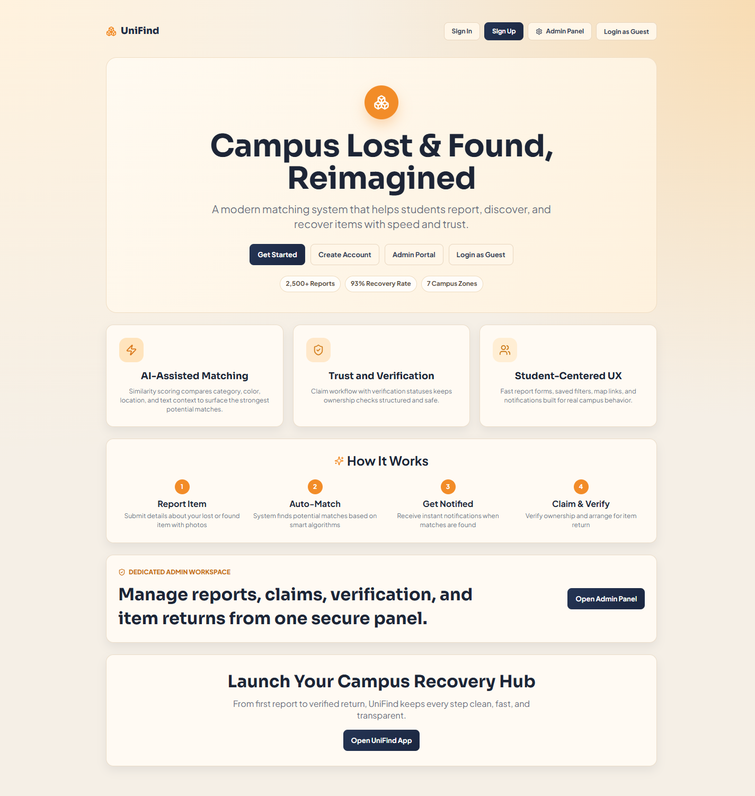
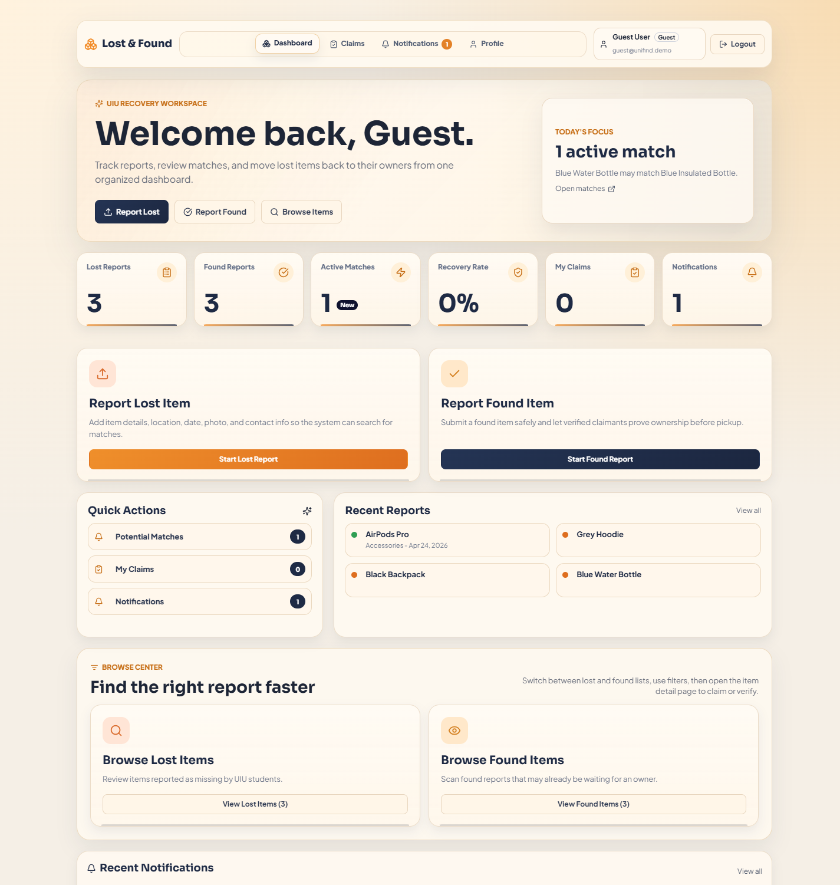
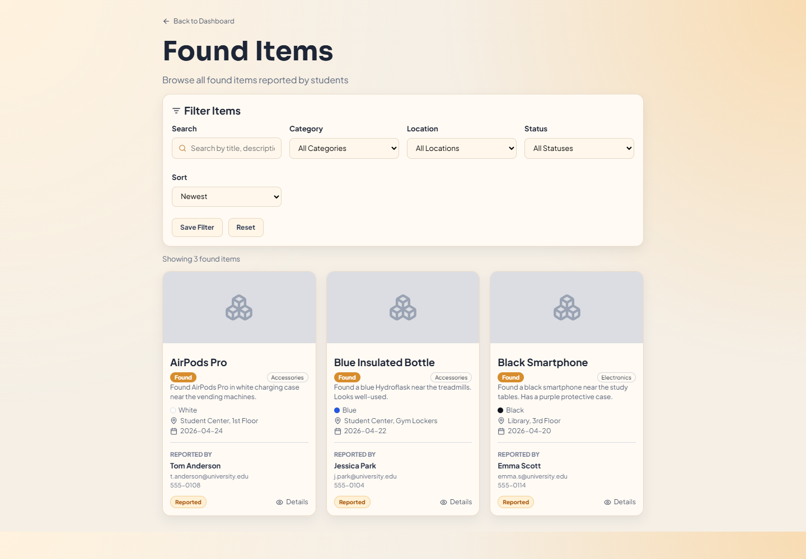
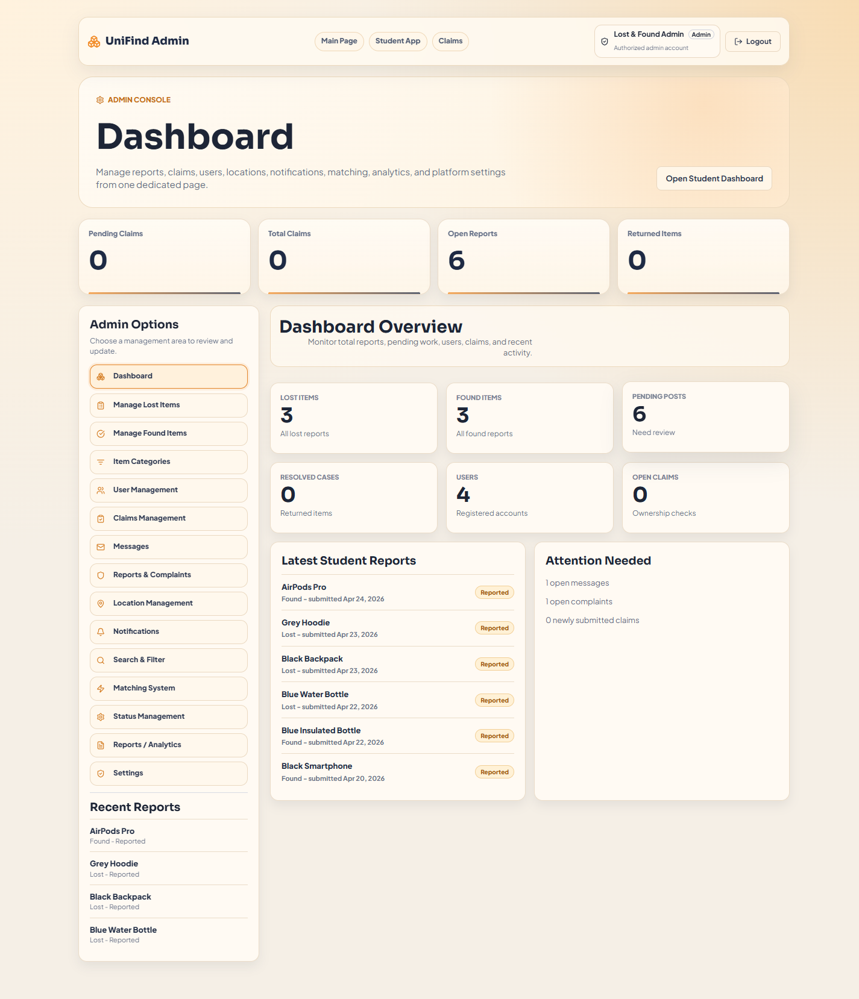
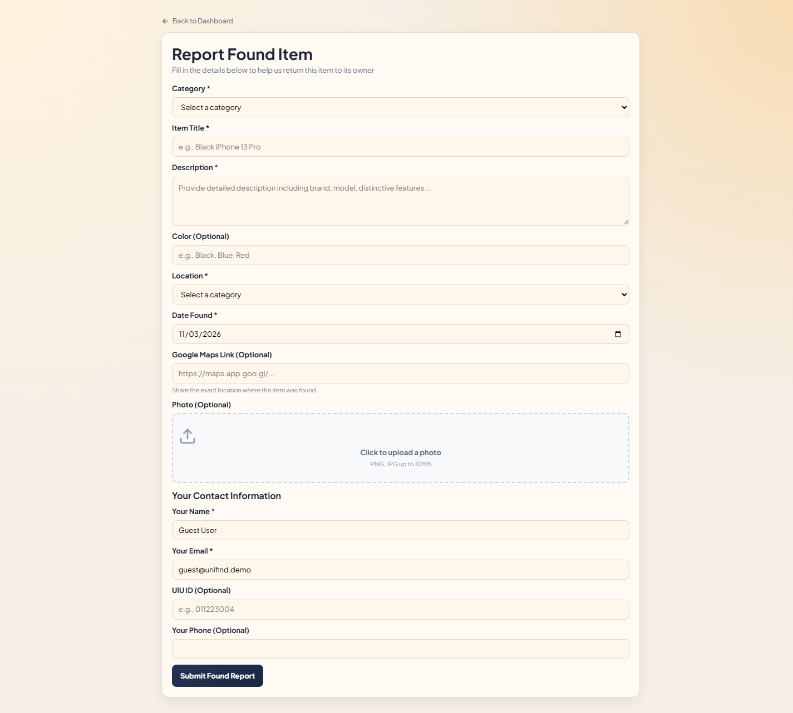
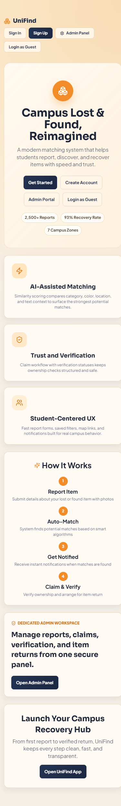
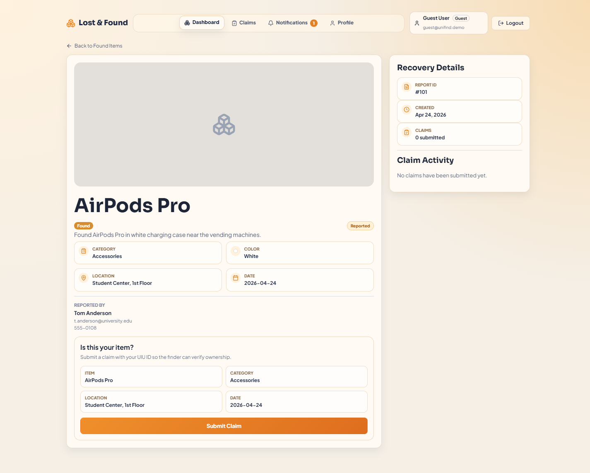

# UniFind agency showcase assets

Live demo: https://unifind-showcase.vercel.app

## Suggested project copy

**UniFind — Campus Lost & Found**

A responsive campus recovery platform that brings lost-and-found reports, item discovery, similarity matching, ownership claims, and administration into one organized experience.

Stack: React, Vite, React Router, Zustand, Framer Motion, and Vercel.

This is an interactive portfolio demo using browser-local data. The figures displayed on the landing page are sample marketing content, not verified customer outcomes.

## Screenshot selection

| File | Suggested use |
| --- | --- |
| `01-home-desktop.png` | Main agency project thumbnail or desktop preview |
| `02-home-full-page.png` | Full landing-page case study |
| `03-student-dashboard.png` | Student experience and feature overview |
| `04-browse-found-items.png` | Item discovery and filtering |
| `05-admin-dashboard.png` | Administration and operations |
| `06-report-found-item.png` | Reporting workflow |
| `07-home-mobile.png` | Responsive mobile showcase |
| `08-item-details.png` | Item details and ownership claims |

Desktop screenshots use a 1440px viewport; the mobile screenshot uses a 390px viewport. Images show the application's original seeded demo content and placeholders. No real user submissions were added for these screenshots.

## Gallery

### Home page

### Full landing page

### Student dashboard

### Found-item browser

### Administration dashboard

### Report form

### Mobile layout

### Item details

